# Async Job Queue

A production-shaped REST API backed by an asynchronous, durable job queue. Clients submit work and get a job
id back immediately; a horizontally scalable worker tier executes jobs with per-attempt timeouts, exponential
back-off retries and a dead-letter store; every job's lifecycle is visible through the API and metrics.

**Stack:** Java 21 · Spring Boot 3.5 · PostgreSQL 16 (queue + result store) · Flyway · Micrometer/Prometheus ·
Testcontainers · GitHub Actions · DigitalOcean App Platform.

- [Architecture & lifecycle diagrams](docs/architecture.md)
- [Delivery semantics: at-least-once, duplicates, fencing](docs/delivery-semantics.md)



---

## Quick start

**With Docker (API + workers + Postgres):**

```bash
docker compose up --build                     # API on :8080, 1 worker
docker compose up --build --scale worker=4    # scale workers independently of the API
```

**Without Docker for the app** (needs a Postgres 16 on localhost:5432, database `jobqueue`):

```bash
mvn spring-boot:run                           # JOBQUEUE_ROLE=all: API + workers in one process
```

**Try it:**

```bash
# Submit (202 + Location header). Only "type" is required.
curl -s -XPOST localhost:8080/api/v1/jobs -H 'Content-Type: application/json' \
  -H 'Idempotency-Key: demo-1' \
  -d '{"type":"flaky","payload":{"failTimes":2},"priority":5,"maxRetries":3,"timeoutMs":5000}' | jq

curl -s localhost:8080/api/v1/jobs/<id> | jq            # status, attempts, lastError, result
curl -s localhost:8080/api/v1/jobs/<id>/attempts | jq   # per-attempt history (worker, outcome, error)
curl -s localhost:8080/api/v1/queue/stats | jq          # depth, delayed, running, oldest age, paused
```

## API

| Method & path | Purpose |
|---|---|
| `POST /api/v1/jobs` | Submit. Body: `type` (required), `payload`, `priority` 0–9, `maxRetries` 0–25, `timeoutMs` 100–3 600 000, `runAt` *or* `delayMs`. Header `Idempotency-Key` (optional). → `202` new job, `200` existing job for a repeated key. |
| `GET /api/v1/jobs/{id}` | State (`QUEUED`, `RUNNING`, `FAILED`, `SUCCEEDED`, `DEAD_LETTERED`, `CANCELLED`), attempts, last error, result. |
| `GET /api/v1/jobs?status=&type=&limit=` | List recent jobs. |
| `GET /api/v1/jobs/{id}/attempts` | Attempt history. |
| `POST /api/v1/jobs/{id}/cancel` | Cancel a pending job. `409` if running or finished. |
| `GET /api/v1/queue/stats` | Queue depth (eligible now), delayed, running, oldest-ready age, counts by status, paused flag. |
| `POST /api/v1/queue/pause` · `/resume` | **Drain**: stop dispatch cluster-wide; in-flight attempts finish; submissions are still accepted. |
| `POST /api/v1/queue/purge?type=` | **Cancel** all pending jobs (optionally one type). Running jobs are not touched. |
| `GET /api/v1/dead-letters` | Dead-letter store. |
| `POST /api/v1/dead-letters/{jobId}/replay` | Re-queue a dead-lettered job with a fresh retry budget. |
| `POST /api/v1/recurring-jobs` | `{"name","cron","zone","job":{…submission…}}`; 5- or 6-field cron. |
| `GET /api/v1/recurring-jobs` · `DELETE /api/v1/recurring-jobs/{id}` | Manage recurring jobs. |
| `GET /actuator/health` · `/actuator/prometheus` | Health probes, metrics. |

Errors are RFC 9457 `application/problem+json`.

**Status semantics.** `FAILED` means *the last attempt failed and a retry is scheduled* (visible back-off).
The terminal failure state is `DEAD_LETTERED`.

## Writing a handler

A handler is a Spring bean:

```java
@Component
class SendInvoiceHandler implements JobHandler {
    public String type() { return "send-invoice"; }

    public JsonNode handle(JobContext ctx) throws Exception {
        var invoiceId = ctx.payload().get("invoiceId").asText();
        // Idempotent side effect: use the job id as the downstream idempotency key.
        billing.send(invoiceId, /* idempotencyKey */ ctx.jobId().toString());
        return JsonNodeFactory.instance.objectNode().put("sent", true);
    }
}
```

- Return a result → `SUCCEEDED`. Throw any exception → retried with back-off. Throw
  `NonRetryableJobException` → dead-lettered immediately (bad input should not burn retries).
- Respect interruption: the attempt timeout interrupts the handler thread.
- Be idempotent (delivery is at-least-once): `ctx.jobId()` is a stable idempotency key and `ctx.attempt()` a
  monotonic fencing token. See [delivery semantics](docs/delivery-semantics.md).

Built-in demo handlers: `echo`, `sleep` (`{"ms":…}`), `flaky` (`{"failTimes":…}`), `fail`
(`{"retryable":false}`).

## Worker configuration

All settings are in `application.yml` under `jobqueue.*`; the common ones have environment variables.

| Setting | Env | Default | Meaning |
|---|---|---|---|
| `jobqueue.role` | `JOBQUEUE_ROLE` | `all` | `api` (REST only), `worker` (workers + reaper + cron), `all` |
| `jobqueue.worker.concurrency` | `WORKER_CONCURRENCY` | `8` | Max concurrent attempts per process |
| `jobqueue.worker.batch-size` | `WORKER_BATCH_SIZE` | `8` | Max jobs claimed per poll (never more than free slots) |
| `jobqueue.worker.poll-interval` | `WORKER_POLL_INTERVAL` | `500ms` | Idle poll interval (busy workers poll continuously) |
| `jobqueue.worker.lease-grace` | | `5s` | Lease = attempt timeout + grace; covers commit latency and GC pauses |
| `jobqueue.worker.reaper-interval` | | `5s` | How often expired leases are recovered |
| `jobqueue.worker.shutdown-grace` | | `30s` | On SIGTERM, how long in-flight attempts may finish |
| `jobqueue.retry.base-delay` / `max-delay` / `multiplier` / `jitter` | | `1s` / `5m` / `2.0` / `true` | Back-off: `min(max, base·mult^(n-1))`, jittered to `[d/2, d]` |
| `jobqueue.defaults.max-retries` / `timeout` / `priority` | | `3` / `30s` / `0` | Applied when a submission omits them |
| `spring.datasource.hikari.maximum-pool-size` | `DB_POOL_SIZE` | `20` | Keep ≥ concurrency + 4 |
| | `LOGGING_STRUCTURED_FORMAT_CONSOLE` | `ecs` in Docker | JSON logs; worker logs carry `jobId`, `jobType`, `attempt` in MDC |

## How it works (short version)

- **Queue = a Postgres table.** Workers claim with one statement:
  `UPDATE jobs … WHERE id IN (SELECT … ORDER BY priority DESC, run_at FOR UPDATE SKIP LOCKED LIMIT n) RETURNING *`,
  served by a partial index on pending rows. Claiming sets `RUNNING`, increments `attempts`, and grants a lease
  of `timeout + grace`.
- **Fencing.** Every later write is conditional on `attempts = n AND lease_owner = me`. A worker that lost its
  lease cannot overwrite a newer attempt.
- **Crash recovery.** A reaper on every worker node turns expired leases into failed attempts (retry or DLQ).
- **Retries.** Failure sets `FAILED` and `run_at = now + back-off`; the job becomes claimable again at that time.
- **Dead letters.** Exhausted or non-retryable jobs move to `DEAD_LETTERED` and `dead_letters` in one transaction.
- **Delayed and cron jobs.** `run_at` in the future = delayed. Recurring definitions are materialised into ordinary
  jobs by a leaderless scheduler, idempotently per fire time.

Details and trade-offs: [docs/architecture.md](docs/architecture.md).

## Observability

Prometheus metrics at `/actuator/prometheus` (also `/actuator/metrics`):

| Metric | Type | Meaning |
|---|---|---|
| `jobqueue_queue_depth{state=ready\|delayed\|running}` | gauge | Queue depth |
| `jobqueue_queue_oldest_ready_age_seconds` | gauge | How long the oldest eligible job has waited — the best "are we keeping up?" and autoscaling signal |
| `jobqueue_workers_busy`, `_capacity`, `_utilization` | gauge | Worker utilization per process |
| `jobqueue_job_queue_wait_seconds{type}` | timer (p50/p95 + histogram) | Eligible → claimed |
| `jobqueue_job_execution_seconds{type,outcome}` | timer | Handler time per attempt |
| `jobqueue_job_end_to_end_seconds{type,outcome}` | timer | Submit → terminal, including retries |
| `jobqueue_jobs_finished_total{type,outcome}` | counter | Terminal outcomes |
| `jobqueue_jobs_retried_total{type,reason}` | counter | Retries scheduled |
| `jobqueue_jobs_dead_lettered_total{type,reason}` | counter | **Dead-letter rate** = `rate(...[5m])`; ratio = DLQ / finished |
| `jobqueue_jobs_lease_expired_total`, `jobqueue_jobs_stale_completions_total` | counter | Crash recoveries; fenced duplicate executions |
| `jobqueue_dead_letters_pending` | gauge | Dead letters awaiting replay |

Queue gauges are refreshed from the database every 5 s by a background task, never on scrape.

## Handling high load

**Where the limits are.** The API tier is stateless and scales horizontally; a submission is one indexed
`INSERT`. Workers scale horizontally; `SKIP LOCKED` means adding workers adds throughput without lock
contention. The shared resource is the Postgres primary: a single well-provisioned instance comfortably handles
low thousands of claims/completions per second with this schema.

**Scaling levers, in order:**

1. **Scale workers on queue age, not CPU.** Autoscale the worker tier on `oldest_ready_age_seconds` (or depth ÷
   throughput). CPU is misleading for I/O-bound handlers. Raise `WORKER_CONCURRENCY` before adding instances
   for I/O-bound work; virtual threads make high per-process concurrency cheap.
2. **Batch claims.** `batch-size` amortises the claim round-trip; claims never exceed free slots, so a crash strands
   at most `concurrency` jobs.
3. **Connection budget.** Total connections ≈ (API replicas × pool) + (workers × pool). Put PgBouncer
   (transaction mode, DigitalOcean connection pools) in front before raising instance counts; the queue uses no
   session state, so transaction pooling is safe.
4. **Keep the hot table small.** Terminal jobs accumulate. Partition `jobs` by `created_at` (or move terminal rows
   to an archive table) and drop old partitions; the partial index on pending rows keeps the claim path fast
   meanwhile. Tune autovacuum for this table — it is update-heavy.
5. **Back-pressure at the edge.** When depth or age crosses a threshold, return `429` with `Retry-After` from the
   submit endpoint (per-tenant quotas in a multi-tenant setup) instead of letting the queue grow unbounded.
   Payload size is capped (256 KB); large inputs should be stored in Spaces/S3 and referenced by URL.
6. **Isolate noisy job types.** Run dedicated worker deployments per type (a `types` filter on the claim query)
   so a slow type cannot starve others; priorities give ordering, not isolation.
7. **Protect dependencies.** Jittered exponential back-off spreads retries after a downstream outage; add a
   per-type circuit breaker / concurrency cap when one dependency is the bottleneck.
8. **Beyond one primary.** If sustained throughput outgrows Postgres (tens of thousands of jobs/s), keep this API
   and the job-status store, and move dispatch to a log/broker (Kafka, or NATS JetStream) with the transactional
   outbox pattern from the `jobs` table. Status reads can move to read replicas earlier than that.

## Scaling workers independently (DigitalOcean)

The same image runs as two App Platform components (see [`.do/app.yaml`](.do/app.yaml)): a **service** `api`
(`JOBQUEUE_ROLE=api`, behind the load balancer) and a **worker** component `workers` (`JOBQUEUE_ROLE=worker`, no
public HTTP), both bound to a managed Postgres.

```bash
doctl apps create --spec .do/app.yaml
# scale only the worker tier:
yq -i '.workers[0].instance_count = 6' .do/app.yaml && doctl apps update <app-id> --spec .do/app.yaml
```

Demo of independent scaling: submit a burst (`for i in $(seq 500); do curl … '{"type":"sleep","payload":{"ms":2000}}'; done`),
watch `/api/v1/queue/stats` depth and `oldestReadyAgeSeconds`, scale `workers` up, and watch depth drain while
the API instance count stays unchanged. Locally the same thing is `docker compose up --scale worker=N`.

## Testing

```bash
mvn verify          # unit tests (surefire) + integration tests against real Postgres (failsafe + Testcontainers)
mvn test            # unit tests only, no Docker needed
```

No Docker? Point the integration tests at any Postgres:
`JOBQUEUE_TEST_JDBC_URL=jdbc:postgresql://localhost:5432/jobqueue mvn verify`.

| Suite | Covers |
|---|---|
| `BackoffPolicyTest`, `CronSupportTest`, `HandlerRegistryTest`, `JobServiceTest` | Back-off growth, cap and jitter bounds; retry decision; cron parsing and zones; handler registration; submission validation and defaults |
| `QueueStoreIT` (no workers) | Priority + FIFO ordering; delayed jobs not claimed early; 8 concurrent claimers × 300 jobs never double-claim; retry → back-off → DLQ; non-retryable; **lease expiry recovery + fencing of a zombie worker's late result**; idempotency; cancel/purge only pending; replay keeps fencing tokens monotonic |
| `JobApiIT` (API + real workers) | Async submission; success/result; transient retries; DLQ after max retries; non-retryable; timeouts; replay; delayed and `runAt`; cron fire + delete; pause/resume (drain); cancel pending / running (409) / unknown (404); purge by type; idempotent submit; validation as problem+json; Prometheus metrics |

CI ([`.github/workflows/ci.yml`](.github/workflows/ci.yml)) runs `mvn verify` on every push and builds the image.

## Known limitations / next steps

- Running jobs cannot be cancelled (add a `cancel_requested` flag that handlers poll via `JobContext`).
- Admin endpoints are unauthenticated; in production they sit behind an operator role at the gateway.
- Idempotency keys do not detect a *different* body reused with the same key (store a request hash and return `422`).
- Polling adds up to `poll-interval` latency on an idle queue; `LISTEN/NOTIFY` on insert would remove it.
- Retention: terminal jobs are kept forever (see *Handling high load* §4).
