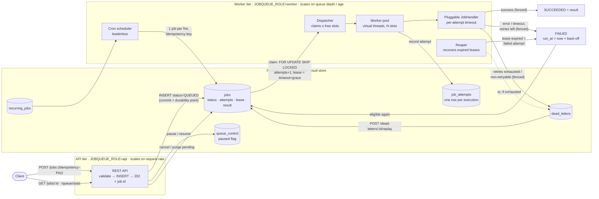
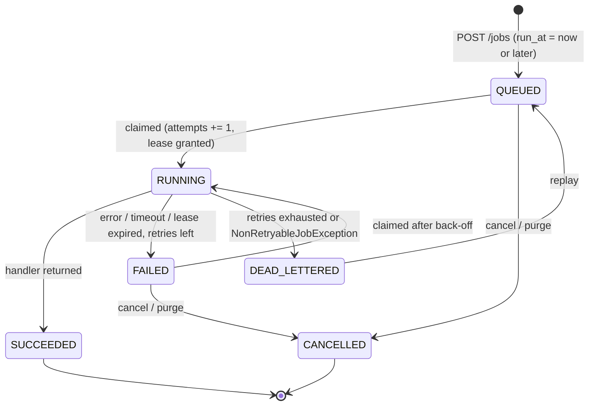
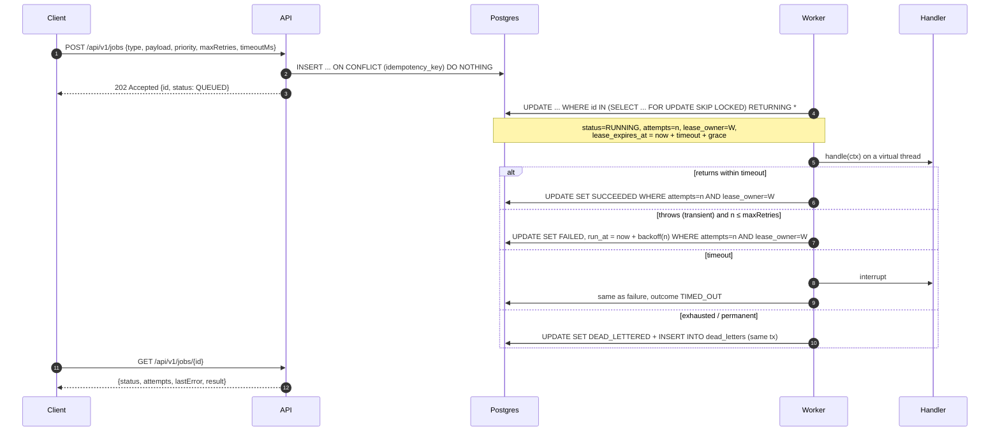

# Architecture

## Components and data flow

Mermaid source (rendered natively by GitHub)

## Job lifecycle

`FAILED` is intentionally **not terminal**: it means "the last attempt failed and a retry is scheduled", so
callers can see a job is struggling before it gives up. The terminal failure state is `DEAD_LETTERED`.

## One attempt, end to end

## Key design decisions

| Decision | Why | Trade-off accepted |
|---|---|---|
| **Postgres as the queue** (`SELECT … FOR UPDATE SKIP LOCKED`) | One durable system for queue + status + results; transactional state changes (job + dead letter + attempt row commit together); no dual-write between a broker and a status DB. | Throughput ceiling of one primary (thousands of jobs/s, not millions). See README → *Handling high load* for the path past that. |
| **Lease per attempt = timeout + grace**, no heartbeats | An attempt can never legitimately run longer than its timeout, so the lease is known at claim time. Removes a whole heartbeat subsystem. | A crashed worker's job waits up to `timeout + grace` before recovery. |
| **`attempts` incremented at claim, used as a fencing token** | Bounds total executions to `maxRetries + 1`, including executions a crashed worker never reported. Every later write is `WHERE attempts = n AND lease_owner = w`, so a zombie cannot overwrite a newer attempt. | A crash consumes a retry. |
| **Database clock for all scheduling** (`now()` in SQL) | API nodes, workers and the reaper may have skewed clocks; lease expiry and `run_at` are compared on one clock. | `runAt` from the client is converted to a delay on the API node (skew there only shifts the start time). |
| **Claim only as many jobs as free slots** | A worker never holds leases on jobs it is not running (no claimed-but-idle head-of-line blocking; a crash strands at most `concurrency` jobs). | One claim query per slot-batch; mitigated by `batchSize`. |
| **One artifact, role selected by `JOBQUEUE_ROLE`** | API and workers scale independently but share code, schema and handler registry. | Handler classes are on the API classpath too (used only to validate job types). |
| **Leaderless reaper and cron scheduler** | Every worker runs them; `SKIP LOCKED` ensures each expired lease / cron fire is processed once. No ZooKeeper, no leader election. | Some redundant polling across nodes (cheap index scans). |
| **Polling, not LISTEN/NOTIFY** | Simple and robust across connection poolers; latency bounded by `pollInterval` only when idle (busy workers loop immediately). | Up to `pollInterval` (500 ms default) pick-up latency on an idle queue. |
